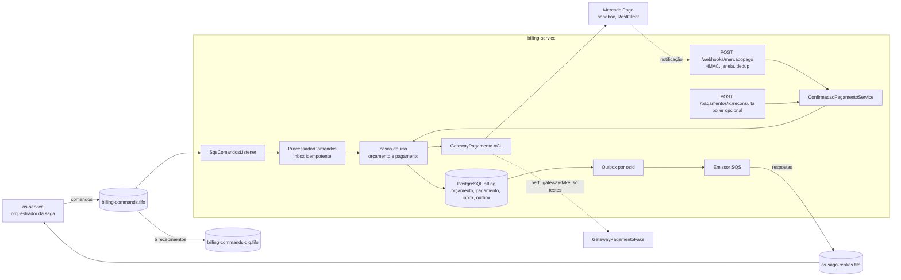

# Serviço de Faturamento (billing-service) — Oficina Mecânica

Serviço Spring Boot independente da Fase 4 que é dono do **orçamento** e do **pagamento (Mercado Pago)** de uma ordem de
serviço. Responde aos comandos da saga do os-service por **SQS FIFO (LocalStack)**, confirma pagamentos a partir de
notificações verificadas do Mercado Pago e tem **PostgreSQL próprio** (banco `billing`). Tudo roda local: PostgreSQL,
LocalStack e Kind efêmero. Nenhum recurso AWS é criado nem alcançado.

- Java 17, Spring Boot 3.5.16, arquitetura hexagonal por feature em `com.oficina.billing`.
- HTTP na porta `8080`, contexto `/billing`; saúde em `/billing/actuator/health` (probes `liveness` e `readiness`).
- Contrato HTTP versionado em [`docs/openapi.json`](docs/openapi.json) (um teste acusa divergência com o gerado).

## Arquitetura



Tudo roda local (PostgreSQL, LocalStack, Kind efêmero); nenhuma chamada a recursos AWS.

## Contratos da saga

Os schemas e fixtures v1 ficam em [`contracts/`](contracts) (congelados no gate G1.5; manifesto `CONTRACTS.sha256`).

| Direção | Tipos |
|---|---|
| Comandos consumidos (`billing-commands.fifo`) | `GerarOrcamento`, `RegistrarDecisao`, `CancelarOrcamento`, `EstornarPagamento` |
| Respostas emitidas (`os-saga-replies.fifo`) | `OrcamentoGerado`, `OrcamentoAprovado`, `OrcamentoRecusado`, `OrcamentoCancelado`, `OrcamentoFalhou`, `PagamentoConfirmado`, `PagamentoRecusado`, `PagamentoExpirado`, `PagamentoEstornado`, `CompensacaoFalhou` |

- `MessageGroupId = osId` e `MessageDeduplicationId = messageId`; respostas copiam `sagaId`, `osId`, `passo`, `correlationId`
  e `traceparent` do comando e usam `causationId` = `messageId` do comando respondido.
- Entrega transacional: inbox idempotente + outbox ordenado por OS no mesmo commit do caso de uso.
- Compensações são idempotentes pela chave de negócio (`osId` + `versaoOrcamento`).
- Um pagamento aprovado **depois** que o orçamento foi cancelado ou o pagamento expirou é estornado automaticamente e
  **não** gera resposta (a saga já seguiu).

## Mercado Pago

- ACL (`GatewayPagamento`) com adaptador REST via Spring `RestClient`: `POST /checkout/preferences` (Checkout Pro /
  API de Preferências), `GET /v1/payments/{id}`, `GET /v1/payments/search?external_reference=` e
  `POST /v1/payments/{id}/refunds`. Testado com WireMock.
- **Webhook** `POST /webhooks/mercadopago`: assinatura `x-signature` (HMAC-SHA256 do manifesto
  `id:{data.id};request-id:{x-request-id};ts:{ts};`) comparada em tempo constante, janela temporal configurável,
  dedup/replay por `x-request-id` + `data.id`, limite de corpo (413, inclusive para `Transfer-Encoding: chunked`, que não declara tamanho) e de taxa (429, por origem,
  para que uma origem que inunde não esgote a janela das notificações legítimas). A notificação **nunca** é confiada:
  o pagamento é relido no provedor e a `external_reference`, o **valor** e a **moeda (BRL)** são conferidos antes de
  confirmar. Divergência não confirma, estorna o cobrado e registra `billing_pagamento_divergente`.
- **Sem túnel HTTPS aprovado** o webhook real não chega ao Kind. A alternativa suportada é a **re-consulta**:
  `POST /pagamentos/{id}/reconsulta` (ADMIN) ou o poller opcional `billing.reconsulta.enabled=true`
  (intervalo `billing.reconsulta.intervalo`, padrão 15s). Ela passa pelo mesmo caminho verificado do webhook. Um túnel
  temporário só com autorização explícita do Rafael.
- **Segredos fora de banda.** Use somente `MP_ACCESS_TOKEN` (e `MP_WEBHOOK_SECRET`, quando existir), injetados no
  ambiente/Secret. Não carregue arquivos de credenciais inteiros no ambiente nem em logs.
- `GatewayPagamentoFake` existe **somente** no perfil `gateway-fake` (testes e BDD automatizado) e **nunca** é evidência
  de pagamento real. A prova de sandbox real e do estorno é do gate G5.

## Como rodar

Pré-requisitos: JDK 17, Docker, `kind` e `kubectl`. PowerShell: `& (Join-Path (Get-Location) 'mvnw.cmd') -B verify`;
Linux/macOS/Git Bash: `bash ./mvnw -B verify`.

> Docker Engine 29+ rejeita a API 1.32 que o docker-java do Testcontainers 1.19 negocia; o Surefire fixa
> `api.version=1.44` (ver `pom.xml`).

### Desenvolvimento local (perfil `local`)

```sh
cp .env.example .env   # valores descartáveis; .env é ignorado pelo Git
docker compose -f docker-compose.local.yml --env-file .env up -d --wait
SPRING_PROFILES_ACTIVE=local,gateway-fake ./mvnw spring-boot:run   # exporta as variáveis do .env antes
docker compose -f docker-compose.local.yml down -v
```

### Kind efêmero

```sh
bash scripts/deploy-kind.sh up       # cluster, dependências locais, imagem do SHA exato e deploy
bash scripts/deploy-kind.sh verify   # saúde + fumaça GerarOrcamento -> OrcamentoGerado; evidência em target/kind-evidence
bash scripts/deploy-kind.sh down     # remove somente o cluster Kind descartável
```

- Overlay padrão `kind-fake` (BDD automatizado). Para o sandbox real: `OVERLAY=kind-sandbox MP_ACCESS_TOKEN=... bash scripts/deploy-kind.sh up`.
- Segredos do deploy (senhas do banco, `JWT_SECRET` de 256 bits) são gerados aleatoriamente a cada execução.
- Contrato local: namespace `oficina-billing`, Deployment/Service `oficina-billing`, banco
  `postgres-billing.data.svc.cluster.local:5432/billing`, LocalStack `localstack.infra.svc.cluster.local:4566`.
  A criação oficial das filas é do Plan 4; `k8s/local-deps/queue-init.yaml` espelha o contrato para o deploy autônomo.

## Banco de dados

- Flyway: `V1__criar_billing.sql` (orçamento, itens, pagamento, outbox, inbox) e `V2__webhook_replay.sql`.
- Papéis separados (`k8s/local-deps/postgres-init/01-roles.sh`, o mesmo script do compose e do pod): `billing_migrator`
  (DDL, dono do schema) e `billing_app` (S/I/U; `DELETE` só em `webhook_evento`), sem acesso a outros bancos.
  `PapeisBancoTest` prova isolamento, ausência de DDL para o papel de execução e acesso negado ao banco `oficina`.

## Controles de segurança (Fase 4)

| Controle | Implementação | Evidência |
|---|---|---|
| S-2 JWT | HS256 com `iss`/`aud`/`kid`/`purpose`/`exp`; 401 para chave diferente, `alg=none`, algoritmo trocado, claims incorretos e vencido; emissão de tokens só em `src/test` | `StaffTokenVerifierTest`, `SegurancaHttpTest`; `TokensTeste` ausente do JAR/imagem (verificado em `docker run ... unzip -l`) |
| S-3 sem escape para AWS | Endpoint na allowlist (`localstack.infra.svc[.cluster.local]`, loopback), credenciais dummy `test/test`, sem identidade AWS; caminho IRSA/STS removido | `PoliticaEndpointLocalTest`, `VerificadorAmbienteLocalTest`, `ControlesDeEntregaTest` |
| S-4 webhook | HMAC constante, janela, dedup/replay, re-fetch com referência/valor/moeda, limites de corpo e taxa, log `mercadopago_webhook_rejeitado` | `AssinaturaWebhookTest`, `SegurancaHttpTest`, `ConfirmacaoPagamentoServiceTest`, `FiltroLimitesWebhookTest`, `JdbcDedupWebhookTest` |
| S-5 gateway fake | Só no perfil `gateway-fake`; simulação exige ADMIN; 404 sem o perfil; startup falha se coexistir com credencial real | `SegurancaHttpTest`, `SimulacaoForaDoPerfilTest`, `VerificadorGatewayFakeTest`, `ControlesDeEntregaTest` |
| S-7 CI/supply chain | `permissions: contents: read`, ações fixadas por SHA, checksum do Maven Wrapper, Gitleaks e Trivy fixados por digest, SAST (SpotBugs + Find Security Bugs), SCA, scanner de artefatos antes do upload | `.github/workflows/ci.yml`, `scripts/scan-artifacts.sh`, `ControlesDeEntregaTest` |
| S-10 imagem/pod | Imagens por digest, usuário 10001, `readOnlyRootFilesystem`, `automountServiceAccountToken: false`, limites de CPU/memória, scan da imagem | `Dockerfile`, `k8s/`, `ControlesDeEntregaTest`, Trivy |

Premissas registradas (revisão de segurança): a allowlist de hosts do SQS (S-3) e as credenciais fixas `test/test` valem
para uso exclusivamente local; quem controla o ambiente do pod controla a allowlist. Postgres e LocalStack de
`k8s/local-deps` são dependências efêmeras locais, sem `securityContext` nem NetworkPolicy (o Kind padrão não aplica
NetworkPolicy). Limite de taxa do webhook por IP de origem não resiste a quem falsifica muitos IPs; ligue
`billing.reconsulta.enabled` quando o webhook real estiver exposto.

Risco aceito nesta fase (S-2): o HS256 usa segredo compartilhado entre os três serviços; comprometer um serviço permite
forjar token de staff nos outros até a expiração. Uso exclusivamente local/Kind.

## Medições (máquina local, JDK 17.0.20, Docker 29.8)

Medido localmente na árvore do PR após as correções de revisão (UNR-130/UNR-131); o CI do PR repete tudo no SHA final. Os números anteriores (219 testes, 96,03%) eram do SHA `21219f1`:

| Verificação | Resultado |
|---|---|
| `./mvnw verify` | 226 testes, 0 falhas, 0 ignorados |
| JaCoCo (linhas; exclui `config`, `*Application*`, `dto`) | 96,22% (739/768); regra de build ≥ 80% |
| SAST SpotBugs + Find Security Bugs (limiar Medium) | 0 achados, com exclusões justificadas em `spotbugs-exclude.xml` |
| Trivy fs (`pom.xml`) e imagem (HIGH/CRITICAL com correção) | 0 achados, com exceções justificadas em `.trivyignore` |
| Gitleaks (histórico e árvore) | 0 vazamentos; única exceção é o segredo JWT de fixture em `src/test` (`.gitleaks.toml`) |
| Kind efêmero (`deploy-kind.sh up/verify/down`) | pod `1/1 Running`, `/billing/actuator/health` = `UP`, fumaça `GerarOrcamento -> OrcamentoGerado` recebida, imagem do SHA exato |

Não medido aqui: SonarCloud, que o suplemento Local Kind exige (a execução depende do Rafael: habilite a variável de repositório `SONAR_ENABLED=true` e o segredo `SONAR_TOKEN`; sem isso o job fica `skipping`),
execução do workflow no GitHub e prova de pagamento real no sandbox (G5).

## Desvios em relação ao Plan 2

- Spring Boot **3.5.16** em vez de 3.2.5: a imagem em 3.2.5 trazia 43 achados HIGH/CRITICAL com correção. Springdoc 2.8.9 e
  `flyway-database-postgresql` acompanham a atualização. Os outros serviços podem permanecer em 3.2.5.
- Sem agente New Relic na imagem (observabilidade é opt-in do Plan 4) e sem Terraform/RDS/ECR/IRSA (superseded pelo Local Kind).
- `scripts/deploy-kind.sh` (bash, também usado no CI Ubuntu) no lugar de `deploy-kind.ps1`.
- O teste de total do orçamento usa o preço unitário já arredondado a 2 casas (`0.335` → `0.34`), igual ao que o banco
  armazena em `NUMERIC(12,2)`, de modo que a soma das linhas é o total.

## Branches e segredos

`main` guarda código entregue; `develop` é a integração. Não versione credenciais: `.env` é ignorado e o CI recebe
segredos pela configuração protegida do GitHub.
